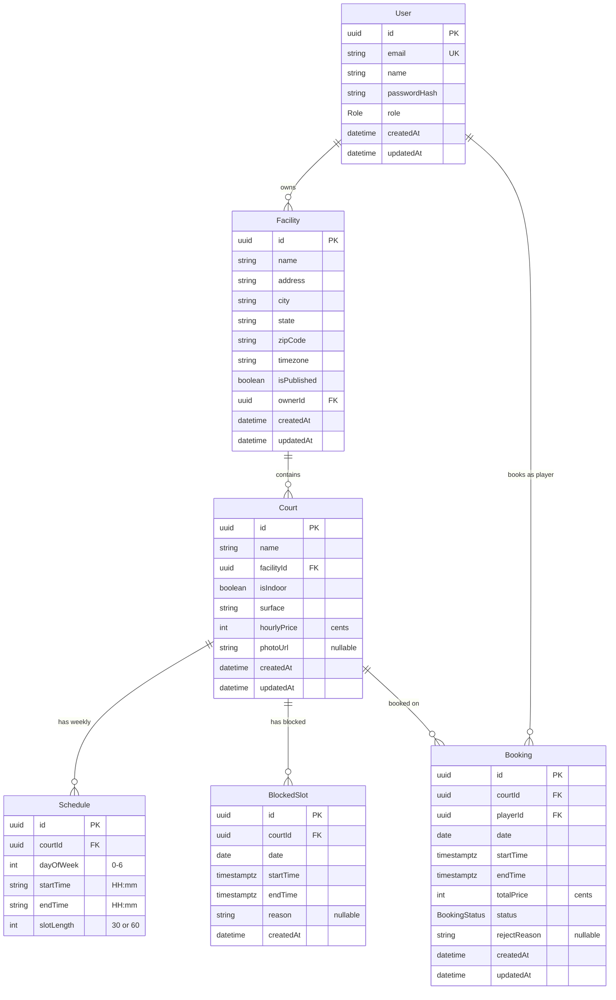

# Data Model

This document describes the PostgreSQL data model managed by Prisma ORM.

## ER Diagram



## Enums

### Role

| Value    | Description                                       |
| -------- | ------------------------------------------------- |
| `PLAYER` | Can search facilities, view availability, book courts, and cancel own bookings. |
| `OWNER`  | Can create and manage facilities, courts, schedules, blocked slots, and approve/reject bookings. |

### BookingStatus

| Value       | Description                                           |
| ----------- | ----------------------------------------------------- |
| `PENDING`   | Booking requested by a player, awaiting owner action. |
| `APPROVED`  | Owner has approved the booking.                       |
| `REJECTED`  | Owner has rejected the booking (reason may be stored in `rejectReason`). |
| `CANCELLED` | Player has cancelled the booking.                     |
| `EXPIRED`   | Booking was not acted on in time and has expired.     |

## Models

### User

Mapped to table: `users`

Represents both players and facility owners in a single table, differentiated by the `role` field.

| Field        | Type     | Constraints          | Notes                    |
| ------------ | -------- | -------------------- | ------------------------ |
| id           | UUID     | PK, auto-generated   |                          |
| email        | String   | Unique               | Login identifier         |
| name         | String   |                      | Display name             |
| passwordHash | String   |                      | bcrypt hash, never exposed via API |
| role         | Role     |                      | `PLAYER` or `OWNER`     |
| createdAt    | DateTime | Default: `now()`     |                          |
| updatedAt    | DateTime | Auto-updated         |                          |

**Relations:**
- Has many `Facility` (as owner)
- Has many `Booking` (as player)

### Facility

Mapped to table: `facilities`

A physical venue that contains one or more courts.

| Field       | Type     | Constraints         | Notes                                   |
| ----------- | -------- | ------------------- | --------------------------------------- |
| id          | UUID     | PK, auto-generated  |                                         |
| name        | String   |                     | Venue name                              |
| address     | String   |                     | Street address                          |
| city        | String   |                     |                                         |
| state       | String   |                     | Two-letter state code                   |
| zipCode     | String   |                     |                                         |
| timezone    | String   |                     | IANA timezone (e.g. `America/New_York`) |
| isPublished | Boolean  | Default: `false`    | Only published facilities appear in public listings |
| ownerId     | UUID     | FK -> users.id      |                                         |
| createdAt   | DateTime | Default: `now()`    |                                         |
| updatedAt   | DateTime | Auto-updated        |                                         |

**Relations:**
- Belongs to one `User` (owner). Cascade delete: deleting the owner deletes all their facilities.
- Has many `Court`.

### Court

Mapped to table: `courts`

A single playing surface within a facility.

| Field       | Type     | Constraints           | Notes                          |
| ----------- | -------- | --------------------- | ------------------------------ |
| id          | UUID     | PK, auto-generated    |                                |
| name        | String   |                       | e.g. "Court 1", "East Court"  |
| facilityId  | UUID     | FK -> facilities.id   |                                |
| isIndoor    | Boolean  | Default: `false`      |                                |
| surface     | String   | Default: `"hard"`     | e.g. "hard", "cushioned"      |
| hourlyPrice | Int      |                       | Price in cents (see Design Decisions) |
| photoUrl    | String?  | Nullable              |                                |
| createdAt   | DateTime | Default: `now()`      |                                |
| updatedAt   | DateTime | Auto-updated          |                                |

**Relations:**
- Belongs to one `Facility`. Cascade delete: deleting the facility deletes its courts.
- Has many `Schedule`, `BlockedSlot`, `Booking`.

### Schedule

Mapped to table: `schedules`

Defines the recurring weekly availability window for a court. Each record represents one day-of-week. Times are in the facility's local timezone.

| Field      | Type   | Constraints                          | Notes                     |
| ---------- | ------ | ------------------------------------ | ------------------------- |
| id         | UUID   | PK, auto-generated                   |                           |
| courtId    | UUID   | FK -> courts.id                      |                           |
| dayOfWeek  | Int    |                                      | 0 = Sunday, 6 = Saturday |
| startTime  | String |                                      | `"HH:mm"` local time     |
| endTime    | String |                                      | `"HH:mm"` local time     |
| slotLength | Int    | Default: `60`                        | 30 or 60 minutes          |

**Constraints:**
- `@@unique([courtId, dayOfWeek])` -- a court can have at most one schedule per day of the week.

**Relations:**
- Belongs to one `Court`. Cascade delete.

### BlockedSlot

Mapped to table: `blocked_slots`

A one-off time range when a court is unavailable (maintenance, private events, weather closures, etc.). Used by the availability engine to exclude slots.

| Field     | Type        | Constraints          | Notes                   |
| --------- | ----------- | -------------------- | ----------------------- |
| id        | UUID        | PK, auto-generated   |                         |
| courtId   | UUID        | FK -> courts.id      |                         |
| date      | Date        | `@db.Date`           | Calendar date           |
| startTime | Timestamptz | `@db.Timestamptz`    | Start in UTC            |
| endTime   | Timestamptz | `@db.Timestamptz`    | End in UTC              |
| reason    | String?     | Nullable             |                         |
| createdAt | DateTime    | Default: `now()`     |                         |

**Relations:**
- Belongs to one `Court`. Cascade delete.

### Booking

Mapped to table: `bookings`

A court reservation made by a player.

| Field        | Type          | Constraints          | Notes                         |
| ------------ | ------------- | -------------------- | ----------------------------- |
| id           | UUID          | PK, auto-generated   |                               |
| courtId      | UUID          | FK -> courts.id      |                               |
| playerId     | UUID          | FK -> users.id       |                               |
| date         | Date          | `@db.Date`           | Calendar date of the booking  |
| startTime    | Timestamptz   | `@db.Timestamptz`    | Start in UTC                  |
| endTime      | Timestamptz   | `@db.Timestamptz`    | End in UTC                    |
| totalPrice   | Int           |                      | Price in cents, computed at creation |
| status       | BookingStatus | Default: `PENDING`   |                               |
| rejectReason | String?       | Nullable             | Set when owner rejects        |
| createdAt    | DateTime      | Default: `now()`     |                               |
| updatedAt    | DateTime      | Auto-updated         |                               |

**Relations:**
- Belongs to one `Court`. Cascade delete.
- Belongs to one `User` (player). Cascade delete.

## Indexes

| Table      | Columns              | Type   | Purpose                                           |
| ---------- | -------------------- | ------ | ------------------------------------------------- |
| users      | email                | Unique | Fast login lookup, enforce uniqueness              |
| schedules  | courtId, dayOfWeek   | Unique | One schedule per court per day                     |
| bookings   | courtId, date        | Index  | Fast lookup of bookings for a court on a given day |
| bookings   | playerId             | Index  | Fast lookup of a player's bookings                 |
| bookings   | status               | Index  | Filter bookings by status                          |

### Double-Booking Prevention (Exclusion Constraint)

The Prisma schema defines the core indexes above. In addition, a PostgreSQL exclusion constraint should be applied at the database level (via a raw migration) to prevent overlapping bookings on the same court:

```sql
ALTER TABLE bookings
ADD CONSTRAINT no_overlapping_bookings
EXCLUDE USING gist (
    court_id WITH =,
    tstzrange(start_time, end_time) WITH &&
)
WHERE (status NOT IN ('CANCELLED', 'REJECTED', 'EXPIRED'));
```

This constraint uses a GiST index to ensure that no two active bookings (PENDING or APPROVED) can have overlapping time ranges on the same court. It operates at the database level, so even concurrent transactions cannot create conflicting bookings -- a guarantee that application-level checks alone cannot provide.

**Prerequisites:** The `btree_gist` PostgreSQL extension must be enabled:

```sql
CREATE EXTENSION IF NOT EXISTS btree_gist;
```

## Relationships Summary

| From        | To       | Cardinality | FK Column   | On Delete |
| ----------- | -------- | ----------- | ----------- | --------- |
| Facility    | User     | Many-to-One | ownerId     | Cascade   |
| Court       | Facility | Many-to-One | facilityId  | Cascade   |
| Schedule    | Court    | Many-to-One | courtId     | Cascade   |
| BlockedSlot | Court    | Many-to-One | courtId     | Cascade   |
| Booking     | Court    | Many-to-One | courtId     | Cascade   |
| Booking     | User     | Many-to-One | playerId    | Cascade   |

All foreign keys use cascade delete. Deleting a user removes their facilities (and transitively all courts, schedules, blocked slots, and bookings). Deleting a facility removes its courts and everything beneath. Deleting a court removes its schedules, blocked slots, and bookings.

## Design Decisions

### Prices in cents (integer)

All monetary values (`hourlyPrice`, `totalPrice`) are stored as integers representing cents (e.g. `2500` = $25.00). This avoids floating-point rounding errors that plague decimal arithmetic. The API returns and accepts cents; the frontend is responsible for formatting to dollars.

### Timestamps in UTC (timestamptz)

Booking and blocked-slot times (`startTime`, `endTime`) use PostgreSQL's `timestamptz` type and are stored in UTC. This ensures correct behavior across time zones and DST transitions. The facility's `timezone` field (IANA format like `America/New_York`) is used by the application layer to convert between local display times and UTC storage.

Schedule times (`startTime`, `endTime` in the Schedule model) are stored as plain `"HH:mm"` strings in the facility's local timezone, because they represent recurring weekly patterns that should follow local clock time regardless of DST shifts.

### Exclusion constraint for double-booking prevention

Application-level checks for overlapping bookings are subject to race conditions under concurrent requests. The PostgreSQL exclusion constraint with GiST index provides a database-level guarantee that no two active bookings can overlap on the same court. This is the gold standard for range-overlap prevention in PostgreSQL and eliminates an entire class of bugs.

### Single User table with Role enum

Rather than separate Player and Owner tables, a single `users` table with a `Role` enum keeps the schema simple. Authorization logic is handled at the API layer. This avoids join complexity and makes it straightforward if a user could eventually hold multiple roles.

### Cascade deletes throughout

All foreign keys cascade on delete. This keeps the data model simple and avoids orphaned records. When a facility is deleted, all its courts, schedules, blocked slots, and bookings are automatically cleaned up. The trade-off is that deletes are destructive -- the application layer should confirm before deleting resources with dependents.

### Schedule unique constraint (courtId, dayOfWeek)

A court has at most one schedule entry per day of the week. This simplifies the availability calculation -- for any given date, there is exactly zero or one schedule window to consider. If a court needs different hours for morning and evening on the same day, the single schedule entry should span the full range and `slotLength` handles the subdivision.
